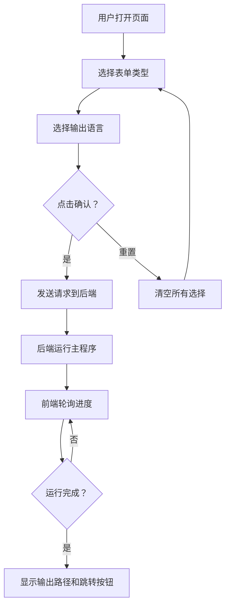

# BOM_API 数据同步工具 - 产品需求文档

## 1. 产品概述

为金蝶 BOM_API 数据同步脚本提供可视化操作界面，用户通过网页选择表单类型和输出语言，一键运行主程序并实时查看进度，完成后获取输出文件路径和快捷跳转。

- 目标用户：需要运行 BOM_API 数据同步工具的内部操作人员
- 核心价值：降低命令行操作门槛，提供直观的选项配置和运行状态反馈

## 2. 核心功能

### 2.1 功能模块

1. **操作面板页**：表单选择、语言选择、确认/重置按钮、进度条、输出结果展示

### 2.2 页面详情

| 页面名称 | 模块名称 | 功能描述 |
|----------|----------|----------|
| 操作面板 | 表单选项区 | 复选框选择要导出的表单类型（9种），支持全选/取消全选 |
| 操作面板 | 语言选项区 | 复选框选择输出语言（CN中文/EN英文），支持全选/取消全选 |
| 操作面板 | 操作按钮区 | 确认按钮（启动程序）和重置按钮（清空所有选择） |
| 操作面板 | 进度条区 | 实时显示程序运行进度和当前步骤文字说明 |
| 操作面板 | 输出结果区 | 显示输出文件路径，提供快捷打开文件夹按钮 |

## 3. 核心流程

1. 用户在页面上勾选需要导出的表单类型（可多选）
2. 用户勾选输出语言（可多选 CN/EN）
3. 点击"确认"按钮，前端将选项发送到后端 API
4. 后端调用 sync_and_generate.py 主程序，按选定选项运行
5. 前端通过轮询获取进度，实时更新进度条和步骤文字
6. 程序运行完成后，显示输出目录路径和快捷跳转按钮
7. 点击"重置"按钮，清空所有选择恢复初始状态

## 4. 用户界面设计

### 4.1 设计风格

- 主色调：深蓝 #1a365d + 金色 #d69e2e（呼应金蝶品牌）
- 辅助色：浅灰背景 #f7fafc，白色卡片
- 按钮风格：圆角按钮，确认按钮为金色，重置按钮为灰色描边
- 字体：思源黑体 / Noto Sans SC
- 布局：居中卡片式布局，分区清晰

### 4.2 页面设计概览

| 页面名称 | 模块名称 | UI 元素 |
|----------|----------|---------|
| 操作面板 | 表单选项区 | 白色卡片，9个复选框网格排列，带图标和描述 |
| 操作面板 | 语言选项区 | 白色卡片，2个复选框横排，带国旗/语言标识 |
| 操作面板 | 操作按钮区 | 金色确认按钮 + 灰色重置按钮，居中排列 |
| 操作面板 | 进度条区 | 渐变进度条 + 步骤文字 + 百分比 |
| 操作面板 | 输出结果区 | 文件路径文本 + 打开文件夹按钮 |

### 4.3 响应式

- 桌面优先设计，适配 1280px+ 宽度
- 平板适配 768px-1280px
- 移动端适配 < 768px

## 5. 表单类型映射

| 表单 ID | 中文名称 | 说明 |
|---------|---------|------|
| BD_MATERIAL | 物料基础资料 | 物料主数据 |
| ENG_BOM | 物料清单 | BOM 清单 |
| PLN_FORECAST | 预测单 | 计划预测 |
| PLN_PLANORDER | 计划订单 | 计划订单 |
| PRD_MO | 生产订单 | 生产制造订单 |
| PUR_PurchaseOrder | 采购订单 | 采购订单 |
| PRD_INSTOCK | 生产入库单 | 生产入库 |
| STK_Inventory | 即时库存 | 库存查询 |
| PRD_PickMtrl | 生产领料单 | 生产领料 |
