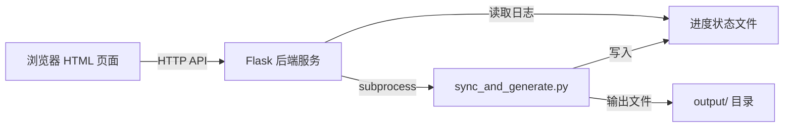

# BOM_API 数据同步工具 - 技术架构文档

## 1. 架构设计



## 2. 技术说明

- 前端：纯 HTML + CSS + JavaScript（单文件，无框架依赖）
- 后端：Flask（Python 轻量 Web 框架）
- 通信：REST API + 轮询进度
- 部署：本地运行，Flask 同时提供静态页面和 API

## 3. 路由定义

| 路由 | 方法 | 用途 |
|------|------|------|
| `/` | GET | 返回操作面板 HTML 页面 |
| `/api/run` | POST | 启动主程序，参数为表单列表和语言列表 |
| `/api/progress` | GET | 获取当前运行进度和状态 |
| `/api/output` | GET | 获取最近一次运行的输出文件列表 |

## 4. API 定义

### POST /api/run

请求体：
```json
{
  "forms": ["BD_MATERIAL", "ENG_BOM"],
  "langs": ["CN", "EN"]
}
```

响应：
```json
{
  "success": true,
  "task_id": "20260609_120000"
}
```

### GET /api/progress

响应：
```json
{
  "running": true,
  "progress": 45,
  "step": "正在生成 ENG_BOM 物料清单...",
  "total_steps": 9,
  "completed_steps": 4
}
```

### GET /api/output

响应：
```json
{
  "output_dir": "C:\\Users\\...\\workspace\\BOM_API\\output",
  "files": [
    {"name": "BD_MATERIAL_物料基础资料.xlsx", "path": "..."},
    {"name": "ENG_BOM_物料清单.xlsx", "path": "..."}
  ]
}
```

## 5. 进度追踪机制

后端通过进度状态文件（JSON）追踪主程序运行状态：

1. 启动主程序前，创建进度文件，记录总步骤数
2. 主程序运行时，通过包装函数在每个步骤完成后更新进度文件
3. 前端每 2 秒轮询 `/api/progress` 获取最新状态
4. 主程序完成后，进度文件标记为完成状态

## 6. 文件结构

```text
workspace/BOM_API/
├── server.py              # Flask 后端服务
├── index.html             # 前端操作面板
├── sync_and_generate.py   # 主程序（已有）
├── map/                   # 映射文件（已有）
├── template/              # 模板目录（已有）
├── data/                  # 数据缓存（已有）
└── output/                # 输出目录（已有）
```
